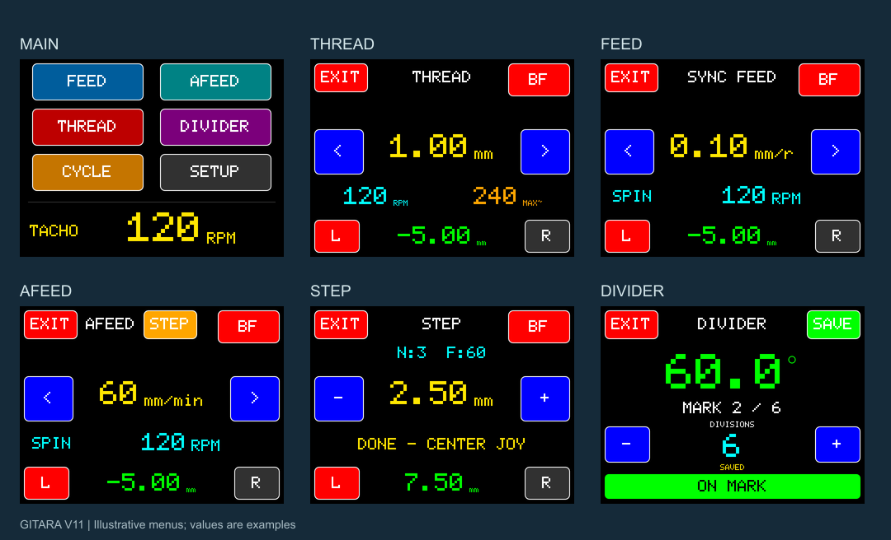

# GITARA — Electronic Lead Screw (ELS), электронная гитара для токарного станка

Electronic Lead Screw (ELS), или электронные шестерни для токарного станка, связывает движение продольной каретки с вращением шпинделя и заменяет подбор механических сменных шестерён для подачи и резьбы.

Продольная подача, нарезание и восстановление резьбы, перемещение на заданное расстояние и деление оборота шпинделя.

GITARA управляет шаговым двигателем продольной подачи по энкодеру шпинделя или по заданной скорости. Управление приводом шпинделя и поперечной подачей остаётся у оператора.

## Документация

- [Принципиальная схема, PDF](docs/GITARA_V11_Schematic_RU.pdf) — один лист; доработки выделены оранжевым.
- [Редактируемая схема EasyEDA](docs/GITARA_V11_Schematic_EasyEDA.json).
- Кронштейны: [двигатель NEMA23, DXF](drawings/nema23-bracket.dxf) · [энкодер, DXF](drawings/encoder-bracket.dxf). Единицы — мм; посадочные размеры сверяются со своей механикой.

- **[Открыть виртуальную GITARA V11](https://dmitriynett-sudo.github.io/gitara-els/)** — полный набор меню, настройки, виртуальный шпиндель, джойстик, микроподача и примеры работы. Браузерная модель не управляет станком и не воспроизводит точность/защиту прошивки.
- [Инструкция пользователя V11, PDF](docs/GITARA_V11_User_Guide_RU.pdf) — настройка под свой станок и обзор меню.
- [Сборка и подключение, PDF](docs/GITARA_V11_Assembly_RU.pdf) — четыре листа с GPIO, согласованием сигналов, драйвером и питанием.
- [Плата, список деталей и таблица контактов](docs/ASSEMBLY_RU.md).
- [Первое включение](docs/QUICK_START_RU.md).
- [Установка готовой прошивки](docs/INSTALL_FIRMWARE_RU.md).
- [Изменения V11](CHANGELOG.md).

Значения на иллюстрациях приведены для примера. Настройки нужно вводить по механике, энкодеру и драйверу своего станка.

## Возможности

| Режим | Назначение |
| --- | --- |
| FEED | Синхронная подача в мм на оборот шпинделя; изменение подачи во время движения. |
| AFEED | Независимая подача в мм/мин. |
| THREAD | Метрические и дюймовые резьбы, правая и левая резьба; сохранение привязки между проходами в выбранном режиме. |
| STEP | Перемещение на заданное расстояние: канавки, шкивы, повторяющиеся операции. |
| DIVIDER | Число делений оборота, угол и звуковое подтверждение попадания на деление. |
| CYCLE | Движение между двумя электронными лимитами с паузой. |
| BF | Компенсация измеренного люфта; мастер начальной настройки. |
| SETUP | Параметры механики, разгон, торможение, диагностика, SD-лог и регистрация. |

## Совместимость

Текущая аппаратная реализация рассчитана на Waveshare RP2350-Touch-LCD-2, квадратурный энкодер A/B и драйвер шагового двигателя с входами STEP/DIR/ENA. Совместимость уровней сигналов и соединения проверяются по паспорту платы и драйвера. Подключение энкодера или драйвера напрямую без проверки уровней может повредить плату.

Нужная плата: **[Waveshare RP2350-Touch-LCD-2, экран 2″ 240×320](https://www.waveshare.com/product/rp2350-touch-lcd-2.htm)**. [Документация и распиновка производителя](https://www.waveshare.com/wiki/RP2350-Touch-LCD-2). Модели 2.1, 2.8 и другие платы не являются заменой для этого UF2.

## Прошивка и активация

**[Скачать GITARA V11 DEMO для RP2350](https://github.com/dmitriynett-sudo/gitara-els/releases/tag/v11-demo-rc1)**. В разделе Assets находятся готовая прошивка UF2, инструкция PDF и контрольные суммы файлов. Для установки скачайте UF2; архивы Source code содержат документацию.

В версии для распространения предусмотрен демонстрационный режим: FEED 0,10 мм/об, AFEED, DIVIDER и THREAD 1,00 мм. Другие шаги резьбы, подачи FEED и режимы STEP/CYCLE открываются активацией для конкретной платы.

Для активации используется DEVICE ID из раздела REGISTER и восьмизначный код, который вводится на экране. Интернет на станке для ввода кода не требуется. Не публикуйте свои коды активации и платёжные данные в Issues.

## Проверка на станке

Перед резанием проверьте направление движения, масштаб DRO и работу лимитов без контакта инструмента с заготовкой. DRO показывает расчётное положение по выданным импульсам; датчика фактического положения каретки нет. Электронные лимиты не заменяют аварийную остановку станка.

## Обратная связь

В Issues можно сообщить о неисправности или предложить улучшение. Укажите версию, режим, настройки механики, выбранную подачу/шаг и порядок воспроизведения. Перед публикацией лога удалите личные данные, идентификаторы плат и коды активации.

## Активация полной версии

Стоимость — **10 долларов за одну плату**, оплата в **USDT, сеть BNB Smart Chain (BEP20)**. Перед переводом отправьте DEVICE ID из SETUP → REGISTER на [dmitriynet@proton.me](mailto:dmitriynet@proton.me) и согласуйте сумму в USDT. После подтверждения перевода код выдаётся вручную; код привязан к этой плате.

Адрес получения:

`0x5408C962E5A43E652782C84E41e1a12F8a28AdDa`

После оплаты пришлите на почту TXID транзакции и DEVICE ID. Используйте только USDT в BNB Smart Chain; комиссия сети оплачивается отдельно. [Порядок активации на странице проекта](https://dmitriynett-sudo.github.io/gitara-els/#activation).
