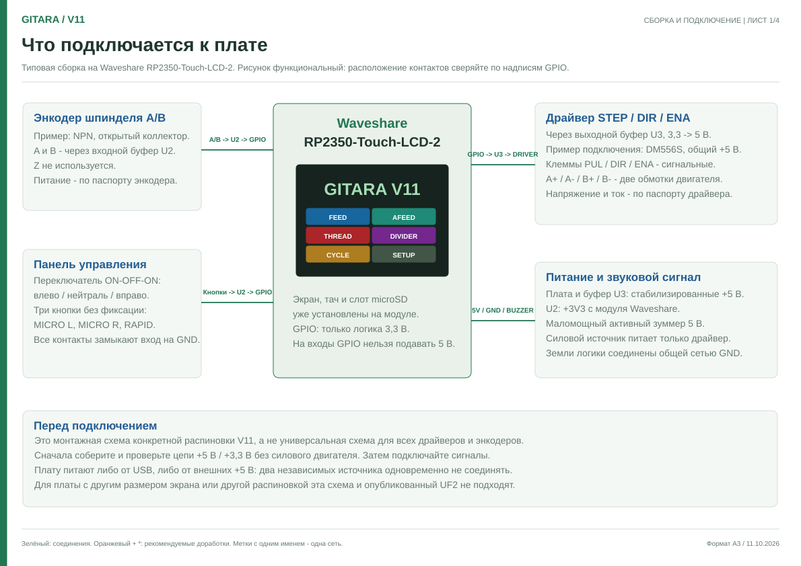

# GITARA V11 — плата и подключение

**[Принципиальная схема, PDF, один лист A2](GITARA_V11_Schematic_RU.pdf)** · [Редактируемая схема EasyEDA](GITARA_V11_Schematic_EasyEDA.json). Короткие проводники с одинаковыми именами цепей электрически соединены. В PDF можно увеличивать любой участок без потери качества.

**[Скачать схему сборки, PDF, 4 листа A3](GITARA_V11_Assembly_RU.pdf).** Для увеличения используйте масштаб PDF. Первый лист — общий порядок подключения, остальные — номера контактов и цепи согласования. Оранжевым отмечены рекомендации для новой сборки.

## Плата

Нужна **[Waveshare RP2350-Touch-LCD-2](https://www.waveshare.com/product/rp2350-touch-lcd-2.htm)**: RP2350, экран 2″, 240×320, ёмкостный сенсор, встроенный слот microSD. [Официальная документация](https://www.waveshare.com/wiki/RP2350-Touch-LCD-2), [схема модуля](https://files.waveshare.com/wiki/RP2350-Touch-LCD-2/RP2350-Touch-LCD-2.pdf).

Для UF2 из Releases используйте именно эту модель. RP2350-Touch-LCD-2.1, 2.8, 2.8C и обычный Pico 2 имеют другое подключение дисплея и не являются прямой заменой.

## Что потребуется

| Узел | Для показанной типовой сборки |
| --- | --- |
| Контроллер | RP2350-Touch-LCD-2. Экран и сенсор уже на плате. |
| Энкодер | A/B, например Omron E6B2-CWZ6C с NPN открытым коллектором, питание 5 В. Линии и передаточное отношение задаются в SETUP. |
| Входной буфер U2 | 74LVC245A, питание 3,3 В; входы этой микросхемы допускают 5 В. |
| Выходной буфер U3 | Для новой сборки SN74ACT125PW, питание 5 В, TTL-входы. Нужен переходник TSSOP-14 или плата под этот корпус. HC125/AC125 не являются эквивалентной заменой для логики 3,3 В. |
| Драйвер и двигатель | Драйвер с оптовходами STEP/DIR/ENA на 5 В; на схеме приведён DM556S. Двигатель и силовой источник выбираются под станок и драйвер. |
| Панель | Переключатель ON-OFF-ON со средним положением и три нормально разомкнутые кнопки MICRO L/R и RAPID. |
| Зуммер | Активный 5 В, ток до 8 мА для показанного подключения без транзистора. Для более мощного или индуктивного нужен подходящий ключ/защита. |
| Питание логики | Стабилизированный источник 5 В, с запасом по току. Для первого включения удобно отдельное питание 5 В. |
| Детали согласования | A/B: две подтяжки 2,2 кОм; кнопки/джойстик: пять по 10 кОм. Резерв B7: 10 кОм. Входы U3: четыре последовательных 1 кОм и четыре подтяжки 47 кОм. U2/U3: по 100 нФ у питания. |

Это пример для указанных типов входов. Другой энкодер, особенно с выходом 12/24 В или дифференциальным выходом, требует подходящего согласования.

## Доработки на принципиальной схеме

Оранжевым показаны изменения для новой сборки:

- **U3 SN74ACT125PW** вместо 74AHCT125: больший допустимый ток выходов для оптовходов драйвера. Корпус TSSOP-14 отличается от SO-14; это требует переходника или изменения разводки.
- **R25–R28, 47 кОм** задают исходное состояние входов U3 при запуске. R25/R26/R27 — на GND, R28 — на 3V3.
- **R22–R24, 1,5 кОм** уменьшают ток светодиодной индикации; индикаторы остаются на выходах STEP/DIR/ENA.
- **R21 не устанавливается**: резервному входу B7 достаточно R16 к +5 В.
- **M1 TSR 1-4850WI, 9–72 В → 5 В / 1 А** — вариант питания от силовой шины вместо DD4012SA. Контакты: 1 VIN, 2 GND, 3 VOUT; шаг 2,54 мм. Габариты и посадку необходимо сверить. F1 — замедленный 1,25 А, с допустимым постоянным напряжением не ниже напряжения цепи (для показанного диапазона ≥80 VDC). Входной фильтр выбирают по документации M1 и помехам конкретного станка; максимальные 72 В относятся также к выбросам. Альтернатива — отдельный стабилизированный источник 5 В.

Бузер оставлен без транзистора, переключатель X1 показан как ON–OFF–ON с разомкнутым средним положением. Номера контактов U1 и соединения GPIO сохранены. Схема не является новой разводкой PCB: оранжевые изменения нужно отдельно перенести на плату.

## Контакты V11

**GPIO — имя контакта на модуле, а не порядковый номер в гребёнке.** Физическое положение сверяйте по распиновке Waveshare. Не подключайте внешние цепи к GPIO дисплея, сенсора или microSD.

| Сигнал | GPIO | Цепь |
| --- | --- | --- |
| Энкодер A | GPIO2 | U2 B0 (18) → A0 (2) → GPIO2 |
| Энкодер B | GPIO1 | U2 B1 (17) → A1 (3) → GPIO1 |
| MICRO L | GPIO3 | Кнопка → U2 B2 (16) → A2 (4) → GPIO3 |
| RAPID | GPIO0 | Кнопка → U2 B3 (15) → A3 (5) → GPIO0 |
| MICRO R | GPIO4 | Кнопка → U2 B4 (14) → A4 (6) → GPIO4 |
| JOY R | GPIO10 | Переключатель → U2 B5 (13) → A5 (7) → GPIO10 |
| JOY L | GPIO6 | Переключатель → U2 B6 (12) → A6 (8) → GPIO6 |
| STEP | GPIO7 | GPIO7 → 1 кОм → U3 1A (2) → 1Y (3) → PUL− |
| ENA | GPIO9 | GPIO9 → 1 кОм → U3 2A (5) → 2Y (6) → ENA− |
| DIR | GPIO8 | GPIO8 → 1 кОм → U3 3A (9) → 3Y (8) → DIR− |
| Зуммер | GPIO22 | GPIO22 → 1 кОм → U3 4A (12) → 4Y (11) → SG1− |

U2: VCC (20) = 3V3, GND (10), DIR (1) и /OE (19) = GND. Направление B → A. Неиспользуемый B7 (11) подтянуть к +5 В через 10 кОм; GPIO5 можно не подключать. Второй резистор от B7 на GND не нужен.

U3: VCC (14) = +5 В, GND (7) = GND; /OE (1, 4, 10, 13) = GND. Подтяжки 47 кОм ставятся **после** последовательных 1 кОм, у входов U3: STEP/ENA/DIR к GND, BUZZ к 3V3. SG1+ = +5 В. Эти подтяжки задают начальное состояние до настройки GPIO.

## DM556S: пример с общим плюсом

Соедините PUL+, DIR+, ENA+ с +5 В логики; PUL−, DIR−, ENA− — с соответствующими выходами U3. Для приведённого DM556S активный оптовход ENA отключает ток двигателя, поэтому GPIO9 HIGH при общем плюсе соответствует включённому драйверу. Проверьте это на своём драйвере: совместимые по названию модели могут иметь другую полярность.

Две обмотки двигателя подключаются к A+/A− и B+/B−. Пары определяют измерением или по паспорту двигателя; цвета не угадывают. Обмотки не подключают и не отключают при включённом драйвере. Драйвер должен работать в режиме STEP/DIR, а не CW/CCW. Ток двигателя и микрошаг выставляются по его руководству; число MICROSTEP в SETUP должно совпадать с драйвером.

## Питание и первый запуск

Подавайте стабилизированные +5 В на **5V** модуля и GND на GND. Контакты **VBAT и 3V3 для этого не используются**. 3V3 с модуля питает U2. Логические земли платы, U2/U3, панели, энкодера и источника 5 В объединяются. При отдельном питании логики силовая цепь драйвера остаётся отдельной; соединение оптовходов показано на листе 4.

Не объединяйте внешние 5 В и USB 5 В как два независимых источника. Если USB нужен для прошивки, отключите внешние 5 В и силовой драйвер. Если логика питается от силовой шины через DC/DC, учитывайте реальные выбросы напряжения при включении и торможении; номинальные 36 В сами по себе не гарантируют пригодность преобразователя.

Сначала без силового драйвера проверьте питание, затем в HW MONITOR — энкодер и кнопки. После подключения двигателя без резания проверьте направление, масштаб DRO, микроподачу, BF и лимиты. Электронные лимиты не заменяют физическую аварийную остановку.

## Документы компонентов

- [74LVC245A, Nexperia](https://assets.nexperia.com/documents/data-sheet/74LVC_LVCH245A.pdf): питание 3,3 В и допустимые входы 5 В.
- [SN74ACT125, Texas Instruments](https://www.ti.com/lit/gpn/SN74ACT125): TTL-входы, питание 5 В и рекомендуемый выходной ток до 24 мА.
- [TSR 1WI, документация TRACO Power у авторизованного дистрибьютора](https://www.mouser.com/datasheet/2/687/tsr1wi_datasheet-2320861.pdf): TSR 1-4850WI, диапазон 9–72 В, выход 5 В / 1 А, предохранитель, распиновка и габариты.
- [Omron E6B2-C](https://www.ia.omron.com/data_pdf/cat/e6b2-c_ds_e_6_3_csm491.pdf): тип выхода и цвета проводов.
- [DM556S, руководство с сайта авторизованного дистрибьютора](https://www.leadtronker.com/Documents/Manuals/CN/DM556S_UM_cn.pdf): ток входов 7–16 мА, цепи оптовходов, ENA и подключение двигателя.

