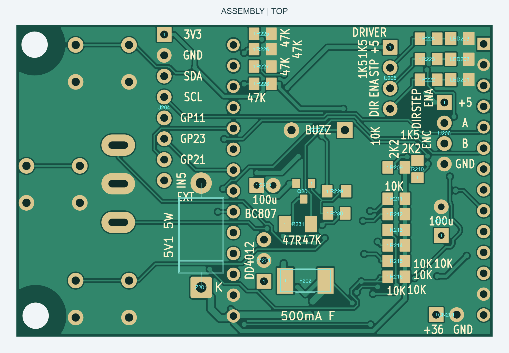
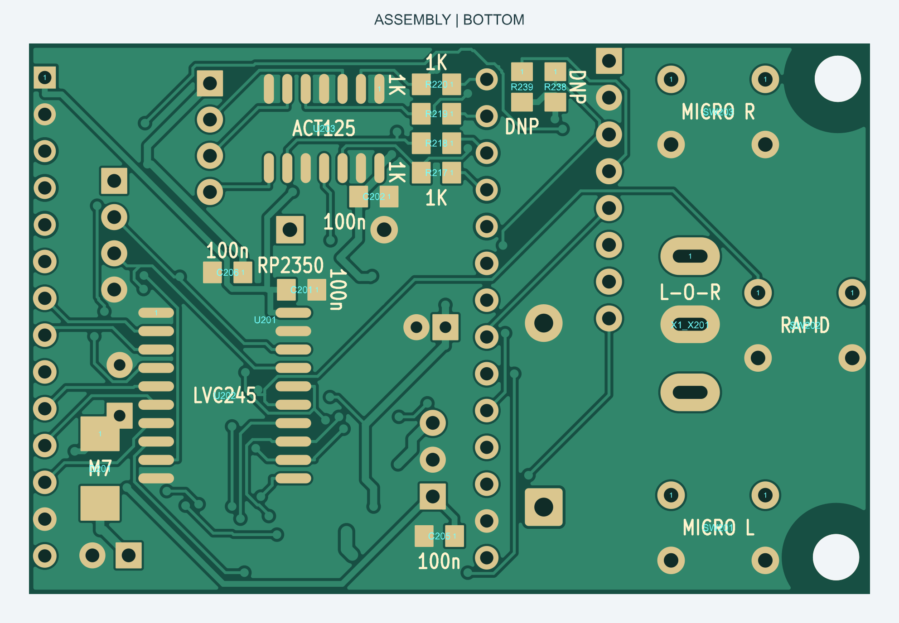

# ELS Pi R6 - схема и печатная плата

Несущая плата для **Waveshare RP2350-Touch-LCD-2** в проекте [GITARA ELS](https://dmitriynett-sudo.github.io/gitara-els/).
Управление одной осью - продольной подачей токарного станка.

- **[Скачать полный комплект KiCad, ZIP](ELS_R6_KiCad.zip)**
- [Принципиальная схема, PDF, 4 листа](ELS_R6_Schematic.pdf)
- [Редактируемый проект KiCad в полном архиве](ELS_R6_KiCad.zip)
- [Готовые Gerber и сверловка](ELS_R6_Gerber.zip)
- [Список деталей, CSV](BOM.csv) · [Распиновка и подключение](CONNECTIONS_RU.md)

## Как открыть

1. Установите **KiCad 10.0 или новее**.
2. Распакуйте весь архив в отдельную папку.
3. Откройте `KiCad/ELS_R6.kicad_pro`. Схема - `ELS_R6.kicad_sch`, плата - `ELS_R6.kicad_pcb`.

Схема содержит четыре листа: питание; модуль и согласование уровней; органы управления и энкодер; драйвер и расширение.
Символы и посадочные места входят в комплект. Таблицы библиотек используют относительные пути;
копировать отдельный файл платы вместо всего проекта для редактирования не требуется.

## Плата и сборка

Габариты **58 x 38 мм**, два медных слоя, толщина 1,6 мм. Два крепёжных отверстия 3,2 мм.
Порядок контактов драйвера: **+5V / STEP / ENA / DIR**; энкодера: **+5V / A / B / GND**.
На J204 выведены 3,3 В, GND, I2C и дополнительные сигналы; назначение каждого контакта приведено в таблице подключения.

**R238 и R239 не устанавливать (DNP)**: подтяжки I2C уже есть на модуле Waveshare.
Позиции деталей нанесены на монтажных картах, номиналы - на шелкографии платы.

| TOP: задняя сторона, разъёмы | BOTTOM: кнопки и тумблер |
| --- | --- |
|  |  |

## Питание R6

DD4012SA, входной диод M7 и конденсатор 100 мкФ / 50 В сохранены.
После DC-DC стоят быстрый предохранитель **F202, 500 мА (0451.500MRL)** и стабилитрон
**Z201, 1N5338BG, 5,1 В / 5 Вт**. Катод Z201 подключён к защищённым +5V, анод к GND.

Работа защиты при пробое DC-DC требует испытаний: значение 5,1 В не является точным порогом отключения.
Не заменяйте F202 перемычкой или самовосстанавливающимся предохранителем.

[Результаты проверки CAD и особенности переноса](CHECKS_RU.md).
